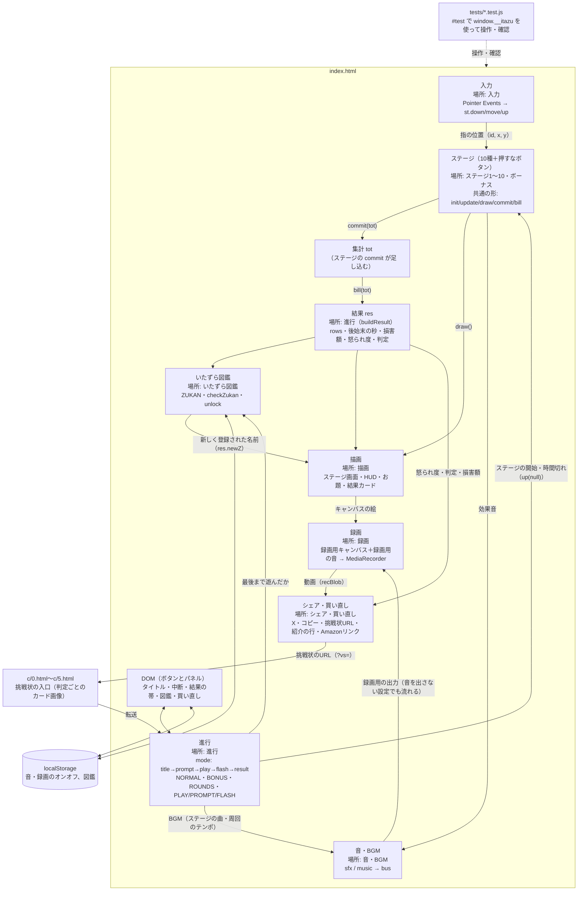

# 処理フロー（いたずラッシュ）

本体は `index.html` 1ファイル。箱はファイルの中の区切り（`/* ---------- 名前 ---------- */`）で、下の図の「場所」はその区切りの名前。

## 受け渡しのメモ
- **ステージ → 集計**：`commit(tot)` で、そのステージの成果を `tot` に足す（`add`）。1回のステージでの最高は `mx` で記録する（図鑑の判定用）。
- **集計 → 結果**：各ステージの `bill(tot)` が `{ v, n, sec, yen, angry }` を返し、`buildResult` が合計して怒られ度と判定を出す。
- **成果を数えるのはプレイ中だけ**（`scoring()`）。時間切れのあと（結果フラッシュ）に増えないようにする。
- **音**：効果音と BGM は `bus` に集まり、リミッターを通って「スピーカー用（音オフならゲイン0）」と「録画用」に分かれる。
- **録画**：画面のキャンバスを横720pxの録画用キャンバスに毎フレーム写して録る。無限モードは録画をずらして足し、最後の70〜140秒だけ残す。
- **テスト**：`#test` のときだけ出る `window.__itazu` で、ステージ順の指定・ハプニングの強制・内部の値の読み取りをする。
