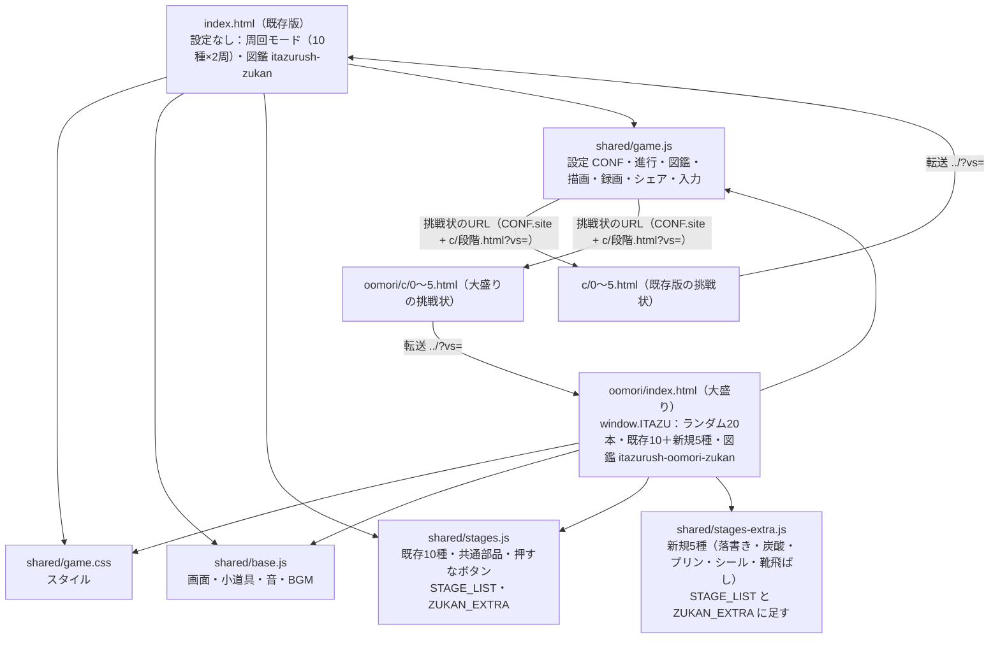
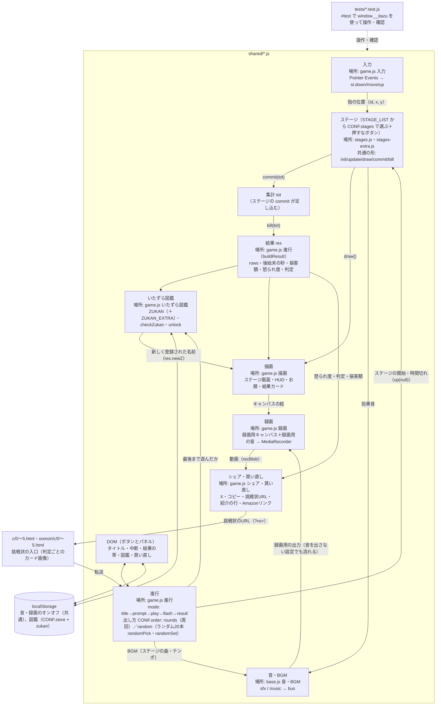

# 処理フロー（いたずラッシュ／いたずラッシュ大盛り！）

ページは2つ（既存版 `index.html` と大盛り `oomori/index.html`）。中身のスタイルとスクリプトは `shared/` を共有する。
スクリプトは普通の `<script src>` を順に読み（base → stages → stages-extra → game）、トップレベルの `const` を共有する。
サイトごとの違いは各ページの設定 `window.ITAZU`（`shared/game.js` の `CONF`）に寄せる。既存版は設定なし＝既定値。
`shared/*.js` の中は `/* ---------- 名前 ---------- */` のコメントで区切ってあり、下の図の「場所」はその区切りの名前。

## ページと設定

## ゲームの中の流れ

## 受け渡しのメモ
- **ページ → 設定**：`window.ITAZU` の項目（`title` `site` `store` `stages` `order` `total` `roundLen` `modeName` `intro`）が `CONF` の既定値を上書きする。既定値は既存版と同じ。
- **出し方**：`order:'rounds'` は今までどおり周ごとにシャッフルして `ROUNDS` 周。`order:'random'` は `total` 本の組（全種類を1回ずつ＋残りは別々の種類）をシャッフルして順に出す（直前と同じは続かない。無限モードは `total` 本ごとに作り直す）。テンポは `roundLen` 本ごとに上がる。
- **ステージ → 集計**：`commit(tot)` で、そのステージの成果を `tot` に足す（`add`）。1回のステージでの最高は `mx` で記録する（図鑑の判定用）。
- **集計 → 結果**：各ステージの `bill(tot)` が `{ v, n, sec, yen, angry }` を返し、`buildResult` が合計して怒られ度と判定を出す。
- **成果を数えるのはプレイ中だけ**（`scoring()`）。時間切れのあと（結果フラッシュ）に増えないようにする。
- **音**：効果音と BGM は `bus` に集まり、リミッターを通って「スピーカー用（音オフならゲイン0）」と「録画用」に分かれる。
- **録画**：画面のキャンバスを横720pxの録画用キャンバスに毎フレーム写して録る。無限モードは録画をずらして足し、最後の70〜140秒だけ残す。
- **テスト**：`#test` のときだけ出る `window.__itazu` で、ステージ順の指定・ハプニングの強制・内部の値の読み取り・ランダムの順番の取り出し（`sampleOrder`）をする。
